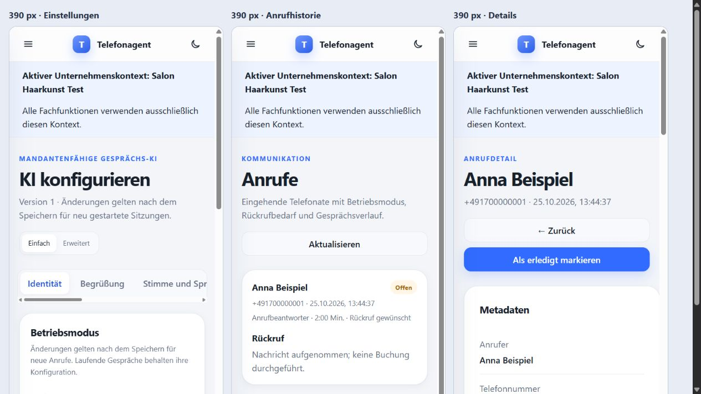
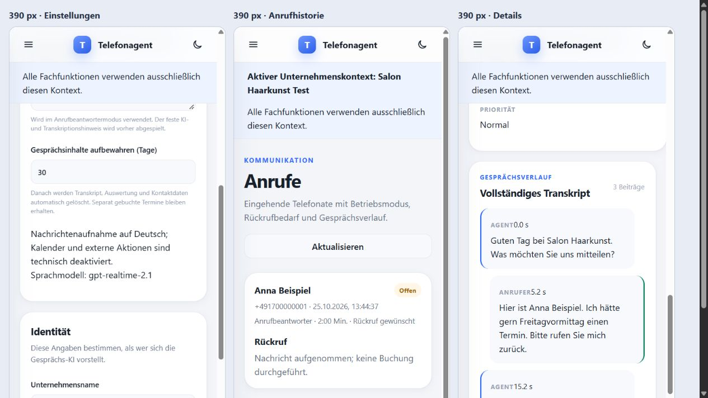
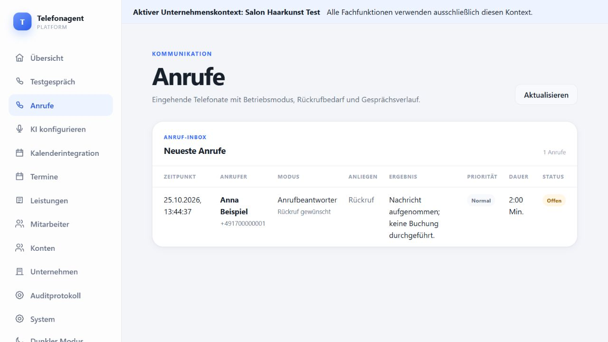

# Verifikation: Betriebsmodi und Gesprächsdokumentation

25. Oktober 2026. Ausschließlich synthetische Daten; keine Produktivverbindung, keine bezahlten OpenAI-Aufrufe und keine echten Telefonanrufe.

**Aktueller Stand:** [Umfassende technische QA und Abnahme nach Fehlerkorrekturen](acceptance-qa-2026-10-25.md). Die nachfolgenden Zahlen und Screenshots dokumentieren den ursprünglichen Implementierungsstand vor dieser zusätzlichen QA.

Anschließend: [Integrationsvorbereitung, vorhandene Providerzugänge und reale Abnahmegrenzen](integration-readiness-2026-10-25.md) sowie [Kurzanleitung für die echten Testanrufe](real-call-checklist.md).

## Prüfungen

Abschlussergebnis: **249 Backendtests erfolgreich**, einschließlich aller elf PostgreSQL-RLS-Tests im gemeinsamen Gesamtlauf; keine übersprungenen Tests in diesem Lauf. **110 Frontendtests erfolgreich**. Ruff, ESLint, Frontend-Produktionsbuild, Compose-Konfiguration und `git diff --check` erfolgreich.

Hinweise ohne Prüfungsfehler: Die vorhandene FastAPI-/Starlette-TestClient-Kombination meldet eine `httpx`-Deprecation; Vite meldet weiterhin ein großes Hauptbundle über 500 kB. Beides verhindert den Build beziehungsweise die Tests nicht.

- Backend: vollständige SQLite-/API-/Kalender-/Authentifizierungs-/Telefoniesuite; zusätzlich PostgreSQL 17 mit eigenem temporärem Datenverzeichnis im RAM und unprivilegierter RLS-Runtime-Rolle.
- Migrationen: vollständiger Aufbau bis 0017 auf SQLite und PostgreSQL; vorhandene synthetische Transkriptinhalte über Upgrade 0016 → 0017 erhalten; alte Modus-/Modellwerte bleiben unbekannt. Bestehender Roundtrip-Test erfolgreich.
- Ereignisverarbeitung: vorläufige/bestätigte Segmente, doppelte und verspätete Inhalte, Abbruch, Transkriptionsfehler, veraltete Analyse nach neuem Transkript und nach Löschung, zeitlich begrenzte Wiederaufnahme und Anbieterfehler.
- Aktionen: Nachrichtenmodus liefert keine Tools und verweigert Dispatcher-/Direktzugriffe; bestehende Kalender- und Bestätigungsprüfungen bleiben in der vollständigen Regression enthalten.
- UI: Modus, Begrüßung und Löschfrist speichern; Historie und Details, Terminwunsch ohne Buchungsbehauptung, Rückruf und vorläufige Transkripte; Desktop und 390-Pixel-Ansichten visuell geprüft.
- Datenschutz: eingeschränkte Löschrechte, Inhaltslöschung ohne Wiederbelebung durch späte Auswertung, kein öffentliches Caching der Historie, Bestandsschutz vor automatischer Löschung.
- Voice: eigene Live-Start-/Audio-/Transkript-/Abschlussereignisse, deutsche Stimmenauswahl, gesperrter Produktionswechsel und simulierte vollständige Evaluationsverbindung.

## Reproduktion

Backend aus `backend`:

```powershell
.venv\Scripts\python.exe -m ruff check app tests
.venv\Scripts\python.exe -m pytest -q tests -p no:cacheprovider --basetemp=../.local-backups/verification-tests
```

Auf diesem Windows-Rechner benötigt der TestClient einen freigegebenen lokalen Loopback-Socket. Der bestehende globale Pytest-Tempordner war nicht beschreibbar; deshalb liegt das temporäre Testverzeichnis im ignorierten Projektordner. Die Tests verändern keine Nutzdatenbank.

Für die elf PostgreSQL-Tests müssen `TEST_POSTGRES_MIGRATOR_URL` und `TEST_POSTGRES_RLS_URL` auf eine ausdrücklich isolierte PostgreSQL-17-Testdatenbank zeigen. Der Runtime-Benutzer heißt im vorhandenen Testfixture `telefonagent_rls_runtime`; ausschließlich synthetische Testzugänge verwenden. Die Migration wird zuvor auf der Testdatenbank mit der Migratorrolle ausgeführt. Keine Produktionsverbindungsdaten verwenden oder protokollieren.

Frontend aus `frontend`:

```powershell
npm.cmd run lint
npm.cmd test -- --run
npm.cmd run build
```

Aus dem Repository: `docker-compose config --quiet` und `git diff --check`.

## Visuelle Evidenz

Die mobile Prüfung rendert dieselben echten App-Seiten in 390 Pixel breiten Frames; keine statischen Mockups. Die temporäre Vorschau verwendet eine eigene SQLite-Datenbank und deaktivierte Anbieterzugänge.







## Aussagegrenzen

Die Tests belegen Protokoll- und Anwendungseigenschaften. Akustische Qualität, reale Providerfreigabe, Twilio-Netzlatenz und Live-Gesamtkosten sind nicht gemessen. Der GPT-Live-Adapter bleibt ein getrenntes Evaluationsangebot für Nachrichtenaufnahme. Die vorhandene Realtime-Telefonie wurde nicht auf Live umgestellt. Ein kontrollierter Telefonie-/Duplex-Hörtest und firmenspezifische Datenschutzfreigaben bleiben Voraussetzung für einen späteren Produktivrollout.
