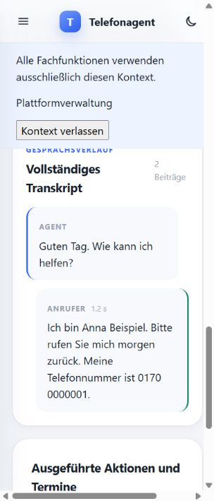

# Integration und reale Telefonieabnahme – Vorbereitungsbericht

Stand: 25. Oktober 2026. Branch `codex/call-modes-documentation-voice`, geprüft auf Basis der technischen QA `1b481be` plus der hier ergänzten Diagnose-/Abnahmehilfen.

## Ergebnis

**Lokale Integration erfolgreich vorbereitet und geprüft. Noch keine Freigabe für echte Testanrufe oder Deployment.**

Die vorhandenen lokalen Zugangsdaten wurden ohne Ausgabe ihrer Werte geprüft. Ausschließlich lesende Twilio-/OpenAI-Kontoabfragen waren erfolgreich. Eine eigene Offline-Abnahmeinstanz derselben Anwendung läuft mit echtem PostgreSQL und RLS. Beide Betriebsmodi und gespeicherte synthetische Gesprächsdaten funktionieren dort über HTTP; die bestehenden Prozesskettentests simulieren weiterhin nur die externe Anbieter-I/O.

Für echte Telefonie fehlen eine ausdrücklich reservierte Testnummer, eine getrennte öffentliche Testadresse und ein eingerichteter Testkalender. Außerdem muss geklärt beziehungsweise abgenommen werden, ob Auflegen durch den Anrufer genügt: ein eigenständiges agentseitiges Auflegewerkzeug existiert derzeit nicht. Die vollständige Anleitung steht in [Echte Testanrufe](real-call-checklist.md).

Keine kostenpflichtigen Anrufe, Audiositzungen, Nummernkäufe, Webhook-Änderungen, Kalendermutationen, Pushes, Merges, Deployments oder Änderungen am Produktivserver wurden ausgeführt. Es gab keine SSH-Verbindung zum Produktivserver.

## 1. Konfiguration und vorhandene Zugänge

Nachweis: [Redigierter Konfigurations-/Kontostatus](integration-preflight-2026-10-25.json). Der neue Befehl `python -m app.telephony_preflight` prüft die tatsächlich durch die lokale Basis-Compose-Datei aufgelöste Backendkonfiguration. Er gibt keine Werte, Tokens, Passwörter, Konto- oder Telefonnummern aus. `--verify-providers` ergänzt ausschließlich GET-Abfragen an die festen offiziellen Endpunkte für Modelle, das Twilio-Konto und dessen Nummern.

| Bereich | Aktueller Befund | Grenze |
| --- | --- | --- |
| OpenAI-Zugang | Vorhanden; GET `/v1/models` erfolgreich. `gpt-realtime-2.1`, `gpt-5.4-nano` und `gpt-live-1` werden gelistet. | Keine Audiositzung eröffnet; tatsächliche Sessionberechtigung, Guthaben, Audioqualität und Kosten nicht bewiesen. |
| Twilio-Zugang | Account-SID-/Tokenformat plausibel; Kontoabfrage erfolgreich, aktives Konto, kein Trialkonto. | Keine Änderung an Account oder Nummernrouting. |
| Nummernbestand | Eine Voice-fähige, bereits geroutete Nummer; keine Voice-unbelegte Nummer sichtbar; Liste nicht abgeschnitten. | Diese Nummer ist nicht als Testnummer freigegeben und wird nicht umgeleitet. Eine vorhandene Voice-URL allein belegt keine Verfügbarkeit für Tests. |
| Webhookvergleich | Die vorhandene Nummer stimmt nicht mit den aus der **lokalen** APP_BASE_URL berechneten Voice-/Status-URLs überein. | Kein Nachweis eines Produktionsfehlers: die lokale Konfiguration kann von der aktiven Produktivversion abweichen. Keine Korrektur am vorhandenen Routing vornehmen. |
| Stream- und Authschutz | Streamgeheimnis mindestens 32 Bytes, Auth-HMAC vorhanden, Transkription aktiv, Rohereignislogging aus. | Prüfung vorhandener Konfiguration, keine Schlüsselrotation. |
| Google-Kalender | OAuth-Clientkonfiguration vollständig; Verschlüsselungsschlüssel syntaktisch gültig. | Kein Nachweis einer gültigen Unternehmensverbindung, eines isolierten Testkalenders oder noch gültiger Refresh-Tokens. Keine bestehenden Kalendertokens entschlüsselt oder kopiert. |
| Microsoft-Kalender | Clientkonfiguration nicht vollständig vorhanden. | Nicht als getesteter echter Kalenderanbieter ausweisen. |
| Lokale URLs | Backend-APP_BASE_URL hat HTTPS; Frontendadresse lokal mit HTTP. | Keine gesonderte HTTPS-Testadresse festgelegt. Dies ist keine fertige öffentliche Test-/Produktionskonfiguration. |
| Migrationseinstellungen | Runtime erhält keine privilegierte Migrations-URL. Standard-Migrationskommando ist `alembic upgrade head`. Lokale Migrations-URL derzeit nicht gesetzt. | Die lokale `.env` darf nicht ungeprüft als Produktions-/Testprofil verwendet werden. Für die Abnahme wurde eine eigene synthetische Rollen-/Migrationskonfiguration eingesetzt. |

Die Dateiinhalte der normalen `.env` wurden nicht verändert. Zugangsdaten wurden weder in die Abnahme-Compose-Datei kopiert noch in Berichte oder Images übernommen. Die neuen Diagnosetests prüfen ausdrücklich die Geheimnisredaktion sowie die Begrenzung auf GET-Abfragen ohne Sprach-/Anrufendpunkte.

## 2. Isolierter lokaler Start

[Offline-Lab und Startanleitung](../../../ops/telephony-lab/README.md) verwenden dieselben Dockerfiles, Anwendungskomponenten und Alembic-Migrationen. Das Lab ist ausschließlich eine lokale Abnahmeumgebung und kein alternativer Produktionsdeploymentweg.

| Ressource | Isolierung |
| --- | --- |
| Compose-Projekt | `telefonagent-local-acceptance`, eigenes Standardnetzwerk, keine Traefik-/Produktionsnetzwerke |
| Frontend | `http://localhost:28081`, nur Loopback veröffentlicht |
| Backend | `http://localhost:28001`, nur Loopback veröffentlicht |
| PostgreSQL 17 | Loopback-Port 25439, eigener Datenbankcontainer, RAM-Dateisystem, keine benannten Datenvolumes |
| Runtime-Rolle | Kein Superuser, kein BYPASSRLS, kein Tabellenbesitz; von Migration/Bootstrap getrennt |
| Zugang und Daten | Bekannte synthetische Offline-Testwerte, Testunternehmen und Prozesskettenfixtures; keine Kunden- oder Produktivdaten |
| Externe Anbieter | OpenAI-/Twilio-Schlüssel leer, keine verbundenen Kalender, Mail aus; dadurch keine unbeabsichtigte echte Sitzung oder Buchung |

Migration, Bootstrap und Healthchecks liefen erfolgreich. Mit dem synthetischen Offline-Zugang wurden die echte HTTP-Anmeldung, CSRF-/Kontextwahl, Einstellungen in beiden Modi und die trockene Runtime-Ermittlung geprüft. Anrufbeantworter: keine Tools. Vollagent: Tools vorhanden. Die ursprüngliche Einstellung wurde nach dem Test wiederhergestellt.

Die vor dem Appstart in PostgreSQL erzeugten synthetischen Prozesskettenanrufe bleiben nach dem Appstart über Historie und Details erreichbar: Zusammenfassung, Name, bestätigter Text, Modus und Aktionsdaten vorhanden. Fremde Testunternehmensanrufe bleiben 404. [HTTP-Smoke-Nachweis](integration-local-smoke-2026-10-25.json).

Zusätzlich im echten Appbrowser geprüft: Anmeldung und Kontextwechsel, Historie und Details beider Modi, gespeicherte Zusammenfassung/Kontakte, Sprechertranskript, das eingefrorene Realtime-Modell und tatsächliche Aktionsanzeige. Im Nachrichtenmodus stehen „Keine Aktionen protokolliert“ und „Keine Terminbuchung verknüpft“; beim Vollagenten ist der erfolgreiche synthetische Katalogaufruf sichtbar. [Lesbarer Browsernachweis des Nachrichtenmodus](integration-answerer-browser.txt). Die ergänzende Sichtprüfung erfolgte in der schmalen Appbrowseransicht; sie ersetzt kein vollständiges neues Responsive-Review.

Die vorhandenen lokalen Stacks blieben aktiv; es wurden ausschließlich Container des neu angelegten Lab-Projekts gestartet beziehungsweise für Testwiederholungen kurz angehalten. Das Lab bleibt für die lokale Sichtprüfung verfügbar. Seine RAM-Daten sind kein dauerhaftes Archiv: beim Stoppen der Datenbank gehen sie verloren. Für spätere echte Abnahmen muss zuvor eine getrennt genehmigte Nachweis-/Aufbewahrungslösung festgelegt werden.

## 3. Automatisierte Prüfungen

| Prüfung dieser Vorbereitung | Ergebnis |
| --- | --- |
| Backend-Gesamtsuite | **282 bestanden**, keine übersprungenen Tests; darin **18 PostgreSQL-/RLS-Tests** und 11 neue Diagnosetests |
| Reale HTTP-/WebSocket-/PostgreSQL-Prozesskette für beide Modi | Bestanden; anschließend beide Fälle für die laufende Lab-Sichtprüfung nochmals gezielt bestanden |
| Frontend | **112 bestanden**, 12 Testdateien; ESLint, TypeScript und Vite-Build bestanden |
| Lokale Docker-Builds | Backend und Frontend aus den aktuellen Quellen erfolgreich; echter Backendprozess und Frontendprozess gesund gestartet |
| Migrationspfad | Lab-Migrationsservice mit `alembic upgrade head` erfolgreich; Stand 0017, Funktion vorhanden, RLS und FORCE RLS erhalten |
| Datenbankrollen | Tatsächliche Lab-Runtime ohne Superuser/BYPASSRLS; Authentifizierung und Anruf-API funktionieren damit |
| Standarddeployment-Struktur | `ops/deploy.ps1 -ValidateOnly` erfolgreich; reine lokale Strukturprüfung, kein SSH und kein Deployment |
| Compose / Ruff / Git-Hygiene | Basis- und Lab-Compose gültig; Ruff und `git diff --check` bestanden |
| Frontend-Bundle | Kein E2E-Stub und keine der geprüften lokalen Geheimnisse im gebauten JavaScript gefunden |
| ORM-/Schemaabgleich | **Weiterhin 51 bereits auf main vorhandene Unterschiede**, keine zusätzlichen Branch-Unterschiede |

Die Pipeline prüft echte Anwendungs-, Authentifizierungs-, SQLAlchemy-, PostgreSQL-, RLS- und Workerlogik. Die externe OpenAI-WebSocket-/Responses-Antwort und Kalenderanbieter-I/O bleiben simuliert. Sie beweist weder echte ASR-Qualität noch sachliche Richtigkeit künftiger realer Zusammenfassungen. Solche Nachweise dürfen erst nach echten Anrufen ergänzt werden.

Hinweise ohne Testfehler: bestehende Starlette-TestClient-Deprecation, großes Frontendhauptbundle und entfernte PURE-Kommentare aus Zod. Der vorherige umfassende [QA-Bericht](acceptance-qa-2026-10-25.md) dokumentiert die behobenen Anwendungs- und Sicherheitsfehler sowie die Paketprüfungen.

## 4. Migration 0017 im vorgesehenen Deploymentpfad

Der Produktionsweg bleibt unverändert: ausdrücklich freigegebener Merge → sauberes lokales `main`, exakt `origin/main` → `./ops/deploy.ps1` → vorhandener Migrationsservice → Runtime-Rechte und Healthchecks. Das Skript behält Projekt `telefonagent`, Root `/docker/telefonagent`, Ports 18001/18081 und das vorhandene Datenvolume bei. Der Code wurde gelesen; der Serverzustand wurde nicht geprüft oder verändert.

0017 erweitert bestehende Tabellen additiv und legt unter PostgreSQL den eingeschränkten Workerresolver an. Der lokale Test verwendet denselben Alembic-Einstieg und PostgreSQL 17 mit getrennten Rollen. Alle Migrationen bis head und die Datenerhalt-/RLS-Regression für 0017 bestehen. Der Standarddeploy erteilt nach der Migration auch Funktionsrechte an die Runtime-Rolle. Der privilegierte Funktionsowner muss weiterhin wie bei den bestehenden Routingresolvern den vorgesehenen Lookup ausführen können; die Runtime selbst darf keine privilegierte Rolle werden.

Die 51 älteren Abweichungen betreffen unter anderem ORM-Abbildung zusammengesetzter Fremdschlüssel, Unique-/Indexdefinitionen und Typbreiten. Ein lesender Vergleich der aktuellen Metadaten mit dem Modell aus `main` bestätigt denselben Befund. **Kein `--autogenerate`, keine automatisch erzeugte Schemaangleichung und kein Entfernen vorhandener Schutzconstraints.** `alembic check` bleibt als allgemeiner Driftcheck nicht grün; diese offene Altlast muss im Review ausdrücklich berücksichtigt werden.

Falls eine frühere Version der unveröffentlichten 0017 bereits auf einer aufzubewahrenden Datenbank ausgeführt wurde, installiert `upgrade head` die später ergänzte Resolverfunktion dort nicht erneut. Vor Deployment Stand und Funktion prüfen und gegebenenfalls eine additive Folgemigration erstellen. Kein Downgrade einer solchen Datenbank zum Nachinstallieren der Funktion. Der synthetische Test-Roundtrip entfernt erwartungsgemäß die neuen 0017-Felder; er ist kein verlustfreier Produktionsrollback.

Vor einem separat genehmigten Rollout bleiben das vorgeschriebene Backup-/Restoreverfahren, Runtime-/Funktionsrechte und das kontrollierte Auslaufen aktiver Telefonate zu prüfen. Der vorhandene Standarddeploy stoppt Backend und Frontend; aktive Gespräche würden sonst unterbrochen. Keine Aussage über vorhandene Produktionsbackups aus dieser lokalen Abnahme ableiten.

## 5. GPT Realtime 2.1 gegenüber GPT Live 1

Die offiziellen OpenAI-Seiten wurden erneut abgerufen. Die Modellliste des vorhandenen Schlüssels enthält beide Modelle; ein erfolgreicher Sprachqualitätsvergleich wurde nicht durchgeführt.

| Eigenschaft | GPT Realtime 2.1 | GPT Live 1 / Integrationsfolge |
| --- | --- | --- |
| Rolle | Sprachmodell mit Reasoning und unmittelbarer Werkzeugauswahl | Full-Duplex-Sprachschnittstelle; Aufgaben/Tools an Responses-Backend oder vorhandenen Client-Agenten delegieren |
| Stand im Repository | Bestehender produktiver Twilio-Protokollpfad; bleibt Standard | Eigenes Protokoll und ausdrücklich gestartete lokale Evaluation für Nachrichtenaufnahme; keine vollständige Produktions-Twilio-/Kalenderintegration |
| Audio / Ereignisse | Bestehende PCMU-Bridge, Input-Buffer-/Response-/ASR-Events | PCMU ist integrierbar, aber eigener Session-/Audio-/Transcript-Lebenszyklus erforderlich; keine bloße Umbenennung des Modellparameters |
| Transkript / Abschluss | Itembezogene bestätigte Segmente und Responsezustände | Fragmente mit Sprecher/Zeitpunkten, teilweise gleichzeitige Ein-/Ausgabe; Wiedergabe unabhängig vom Backendzustand führen. Finalisierung durch `session.closed` bestätigen |
| Tools und Sicherheit | Vorhandener Dispatcher, Slot-/Bestätigungsbindung und Mandantensperren | Handler weiterverwenden, aber Delegations-IDs, Response-IDs, Korrekturversionen, spätere Ergebnisse und Bestätigungen an neues Protokoll anbinden |
| Kostenvergleich | Tatsächliche Text-/Audiotokens und Cache-Nutzung erfassen | Sprachdauer sekundengenau plus separate Backendkosten; Twilio und Nachanalyse bei beiden zusätzlich berücksichtigen |
| Entscheidung | Reale Telefonieabnahme auf diesem Pfad durchführen | Keine produktive Umstellung vor eigenem Qualitäts- und Sicherheitsnachweis |

Quellen: [Realtime 2.1](https://developers.openai.com/api/docs/models/gpt-realtime-2.1), [GPT Live 1](https://developers.openai.com/api/docs/models/gpt-live-1), [Migration und Delegation](https://developers.openai.com/api/docs/guides/live-migration), [Sessionabschluss](https://developers.openai.com/api/docs/guides/live-conversations#usage-and-graceful-close), [Kostenmessung](https://developers.openai.com/api/docs/guides/voice-latency-cost?api=live).

Vergleichsplan nach Kostenfreigabe: identische synthetische deutsche Szenarien aus der Anrufanleitung, mindestens fünf Wiederholungen pro Kandidat/Stimme, gleiche Ausgangsdaten und gleiche Backendregeln. Erheben: Aufgabenerfolg, Namens-/Nummernkorrekturen, sinnvolle Rückfragen, gehörte Unterbrechungsreaktion, falsche Zusagen/Buchungen, Transkriptverlust, bestätigter Abschluss, mediane/p95-Zeit bis zur hilfreichen Antwort und tatsächliche Gesamtkosten. Nicht aus Audiobytes geschätzte Tokenkosten verwenden. Für Live zunächst nur die sicher unterstützte Nachrichtenaufnahme vergleichen; Kalenderfälle erst nach vollständiger Delegationsimplementierung.

Freigabebedingung für einen Modellwechsel: keine unberechtigten oder doppelten Aktionen, keine verlorenen bestätigten Korrekturen, nachgewiesener Nutzen in den festgelegten Qualitäts-/Latenz-/Kostenzielen, gleiche Dokumentations- und RLS-Garantien sowie getestete Rückkehr zu Realtime. Eine gelistete Modell-ID ist kein solcher Nachweis.

## 6. Echte Anrufe und Deploymententscheidung

Der Nutzer muss nach Einrichtung und separater Freigabe die [acht konkreten Testanrufe plus Moduswechselprobe](real-call-checklist.md) durchführen. Nach **jedem** Anruf sind Historie, Transkript, Kontakte, Korrekturen, Auswertung, tatsächliche Aktionen, Ende/Dauer und Fremdzugriff zu prüfen. Die Anleitung enthält ein kurzes Protokollschema; noch kein Fall wird als real bestanden bezeichnet.

Aktuell noch offen:

1. Dedizierte Testnummer und separate öffentliche HTTPS-/WSS-Testadresse verbindlich festlegen; vorhandene produktiv genutzte beziehungsweise nicht freigegebene Nummer unangetastet lassen.
2. Geschützte Testkonfiguration mit tatsächlichen Anbieterrechten, korrekten Webhooks, eigenem Testkalender, Kostenrahmen, Datenschutzhinweis und Aufbewahrung festlegen.
3. Verhalten beim Gesprächsabschluss festlegen: derzeit Auflegen durch den Anrufer beziehungsweise technisches Ende/Limit. Falls selbständiges Auflegen verlangt wird, fehlt dafür noch die implementierte und getestete Capability. Keinen Sprachwunsch oder Abschlusssatz als technischen Verbindungsabbau werten.
4. Reale Telefonie-/ASR-/Zusammenfassungs-/Kalenderfälle abnehmen; auftretende Fehler beheben und gezielt erneut testen.
5. Vor Veröffentlichung und späterem Standarddeployment Migration/Rollen, Backup/Restore und die dokumentierte Schemaaltlast reviewen; anschließend getrennte ausdrückliche Freigaben einholen.

**Deploymentbereit erst nach Erfüllung dieser Punkte.** Realtime kann dann separat zur Veröffentlichung und zum Standarddeployment vorgelegt werden. GPT Live bleibt bis zur zusätzlichen Implementierung und vergleichenden Abnahme gesperrt.
